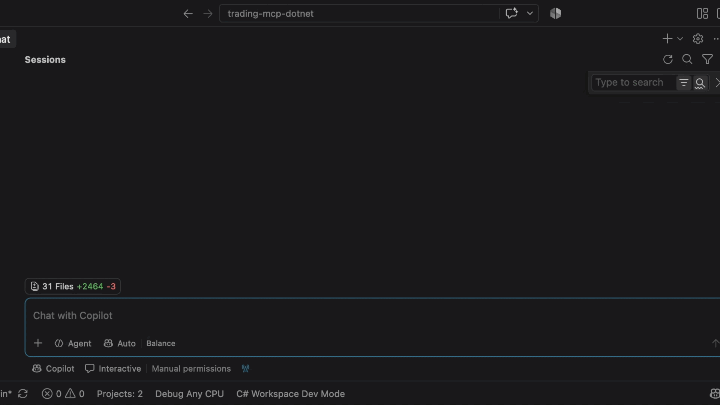
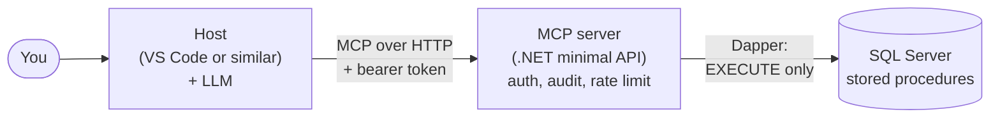

# Secure, read-only MCP server for SQL Server (C# / .NET)

System which allows an AI assistant to query a SQL Server database **without being able to change the database or any of the underlying data**. 
- A minimal API hosts an MCP server using .NET minimal api
- MCP server calls stored procedures via Dapper
- Database login has been granted the least set of priviliges in order to perform its tasks
- MCP server secured using bearer tokens (development)
- MCP server secured using Entra Id (production). Entra Id was formely known as Azure Active Directory.
- Passwords and access keys stored in environment variables (not in code) 

<!-- Add a short GIF of the finished demo here -->
<!---->

> **All data is synthetic.** The companies, clients and prices are invented. The project is for educational purposes only. It is not a production-ready system.

## High Level Architecture



The model decides which tool to call; the host makes the call and returns the result. The server only ever runs
stored procedures, with a login that has no table permissions (uses the principle of least privilege - PoLP).

## Episodes

| # | Video | Git tag | Folders |
|---|-------|---------|---------|
| 1 | Introduction and demo | `ep1-intro` | none |
| 2 | The database and its security | `ep2-database` | `sql/`, `DataGenerator/`, `docker/` |
| 3 | Building the MCP server | `ep3-server` | `McpServer/` |
| 4 | Audit, rate limiting and a real host with a local LLM | `ep4-audit-llm` | `McpServer/` |
| 5 | Deploying to Azure's free tiers (plus the optional Entra ID mode) | `ep5-azure` | `McpServer/`, `docs/` |

Video links: *add as each one is published.* To follow along with an episode's exact code:
`git checkout <tag>`.

## Prerequisites

- [.NET SDK](https://dotnet.microsoft.com/download) 8 or later
- [Docker](https://www.docker.com/products/docker-desktop/)
- [VS Code](https://code.visualstudio.com/) (or another MCP-capable host)
- [Git](https://git-scm.com/)
- An Azure account, only for the deployment episode

While you don't need a deep understanding of .NET or SQL Server, some familiarity with stored procedures, minimal API and perhaps dapper would be useful. An introductory understanding of docker would also be useful.


## Quick start

```bash
git clone https://github.com/Code-Express-AI/trading-mcp-dotnet.git
cd trading-mcp-dotnet

cp .env.example .env                  # set both passwords
open e .env                           # open the .env file in a text editor and update the passwords. Save file
docker compose up -d
docker compose run --rm db-init

cd DataGenerator
dotnet run -- "Server=localhost,1433;Database=TradingDemo;User ID=sa;Password=<SA_PASSWORD>;Encrypt=True;TrustServerCertificate=True" --reset
```

Then configure and run the server: see [docs/setup.md](docs/setup.md).

## Security design

- The MCP database user has **no table permissions**, only `EXECUTE` on a fixed set of stored procedures.
- Procedures return fixed columns with hard row limits and use no dynamic SQL.
- Sensitive columns are masked, and every tool call is written to an audit table.
- Authentication: named bearer tokens for local work, Microsoft Entra ID tokens for production
  ([details and known client limitations](docs/entra-setup.md)).

## Troubleshooting

Biggest issue I found was trying to get VS Code and Copilot to successfully call into the MCP server. After registering the mcp server with VS Code (using the /.vscode/mcp.jsom file) I manually started the mcp server using VS Code. This was a mistake. You only need to register the mcp server. Once you open Copilot chat, it will decide if it needs to start the mcp server or not.

## Tested with

| Component | Version | Date checked |
|-----------|---------|--------------|
| .NET SDK | 8.0.x | *fill in* |
| ModelContextProtocol.AspNetCore | 2.1.0 | *fill in* |
| SQL Server container | 2022-latest | *fill in* |
| Host / model | *fill in* | *fill in* |


The MCP SDK and its authorization support are changing quickly, so check the repo's issues for known problems.

## Licence

MIT. See [LICENSE](LICENSE).

## ToDo
[](https://github.com/Code-Express-AI/trading-mcp-dotnet/actions/workflows/build.yml)
